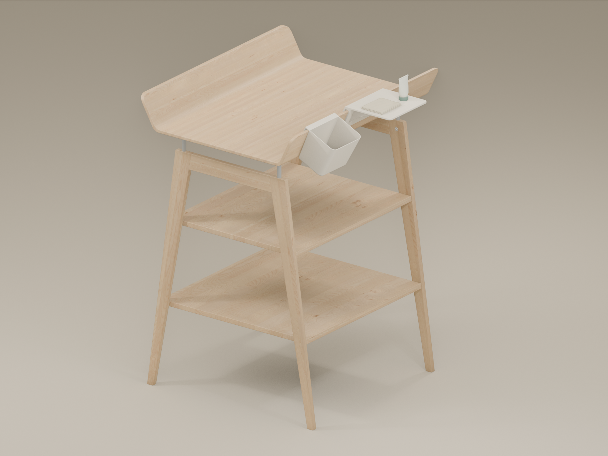

# 3D printing

Printable models, editable sources and product media. Each project keeps its design, styling and validation notes together.

## Projects

| Project | Models | Status |
| --- | --- | --- |
| [Leander Linea accessories](projects/leander-linea/) | Shelf V4 and organizer | Selected for printing. Physical load testing pending. |



Open the project README for print files, previews, animations and simulation results. STL dimensions are in millimetres. The published STL is the accepted print file; generators write new candidates to `generated/`.

## Repository layout

```text
projects/<project>/
  models/       Accepted print files
  source/       Editable models and geometry generators
  renders/      Product images
  animations/   Finished MP4 files
  rendering/    Rendering notes and redistributable source files
  analysis/     Simulation viewers, results and assumptions
rendering/      Shared styling tools, palettes and encoder
docs/           Adding and maintaining projects
```

[Add a project](docs/adding-a-project.md) or [reuse a rendering style](rendering/README.md).

## Use the files

Download the model from its project folder and open it in your slicer. Check units, placement and the project's notes before printing. Rendered images show the digital design. Simulation results describe the stated material, load and support assumptions; they are not measured load ratings.

To work on a design, clone the repository and use the source files. Geometry generators and shared styling tools use Blender 5.0. The Leander gallery shows the accessories mounted on the actual Linea table model. Complete table scenes stay local because the furniture asset cannot be redistributed.

## Licensing and credits

Our models, data, documentation and clean accessory scenes use **CC BY-NC 4.0**. Code uses **MIT**. The table images and videos contain third-party assets and are excluded from that CC grant. See [LICENSING.md](LICENSING.md) for the scope and credits. Downloaded furniture source assets are not included.
