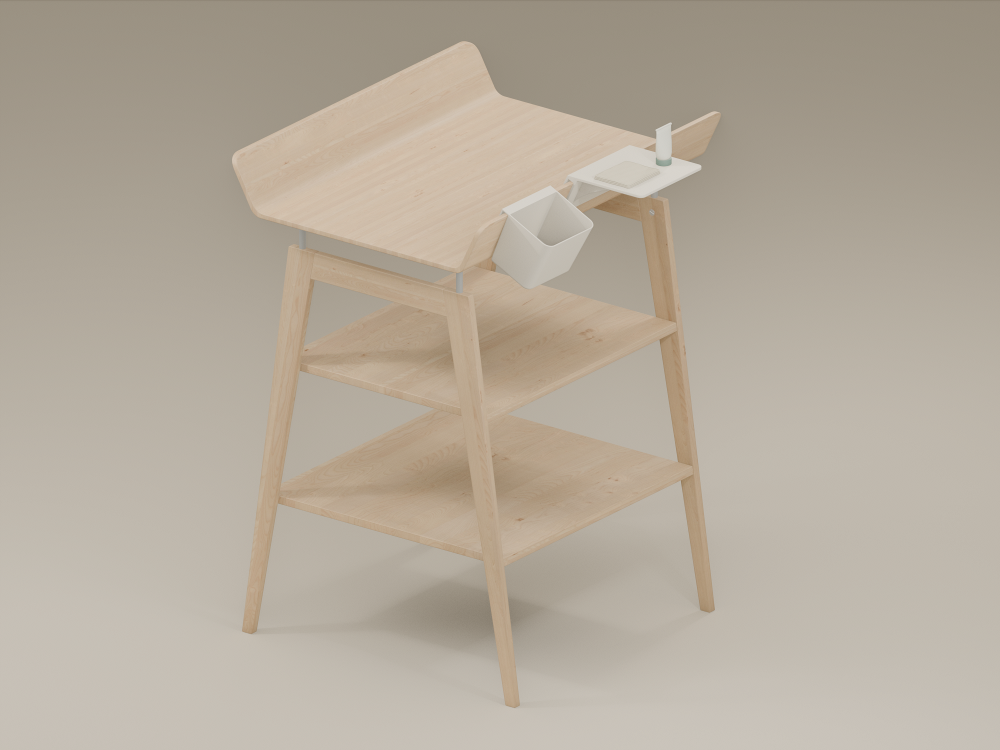
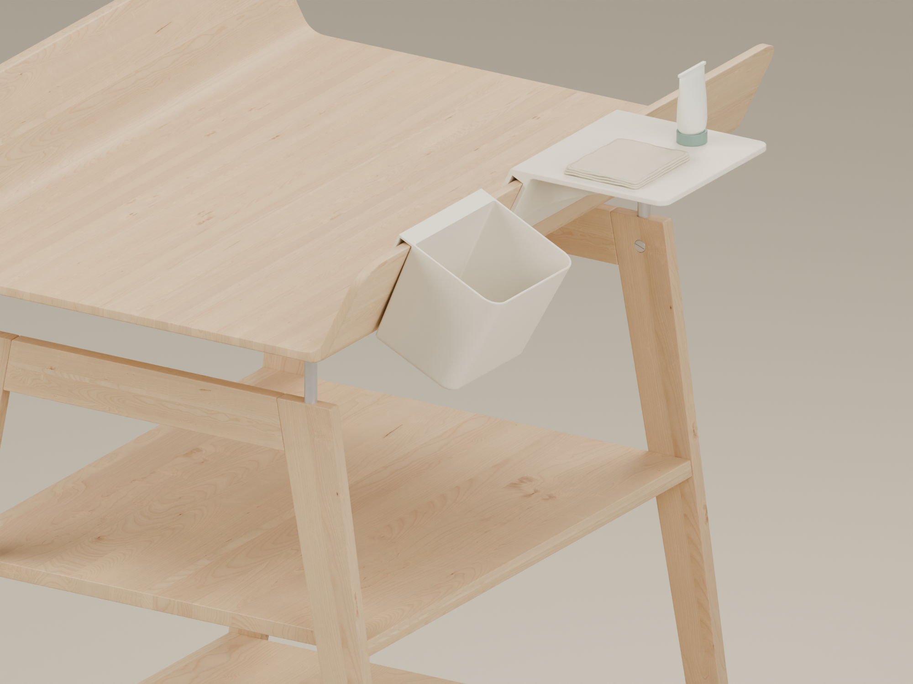

# Leander Linea accessories

A small shelf and hanging organizer for the Linea changing table. The shelf has deeper curved ribs, rounded edges and more space under the front edge. Both files are the versions selected for printing.



## Print files

| Model | Size | File |
| --- | --- | --- |
| Shelf V4 | 180 × 150 mm platform, 6 mm thick | [shelf-v4.stl](models/shelf-v4.stl) |
| Organizer | 140 × 115 × 110 mm overall | [organizer.stl](models/organizer.stl) |

The STLs use millimetres. The shelf is already oriented with its top face on the print bed. The organizer stands on its base. Check the fit and slicer preview before printing. Material, wall count and infill have not been finalized.

The shelf keeps the 13 mm clip opening that fitted the wooden edge. Its three ribs are 5 mm wide, with their exposed tips about 38 mm back from the front edge. The organizer keeps the original folded lip and drafted opening.

These are prototypes for light objects. The simulations are screening calculations, not a verified load rating. Physical testing of the V4 print is still pending.

## Model and media files

The [editable shelf](source/shelf-v4.blend) and [editable organizer](source/organizer.blend) contain the accepted meshes in millimetres. The shelf is shown in its installed orientation. Both scenes contain only the accessory and a procedural material.

The [renders](renders/) show the full Linea table and mounted views of the shelf, rib detail and organizer. Every product image and animation keeps the table in view. These are visual previews; printed photos can be added after testing.

Open the [animation gallery](index.html) locally to watch [shelf V4](animations/shelf-v4.mp4), [the organizer](animations/organizer.mp4) and [both accessories together](animations/combination.mp4), all mounted on the Linea. The [rendering notes](rendering/README.md) explain the shared styles and table asset. Complete scenes containing the table stay local; the editable accessory meshes and their generators are included here.



## Rebuild the models

Use Blender 5.0.1. From this project folder:

```sh
blender --background --threads 2 --python source/build_shelf_v4.py -- --geometry-only
blender --background --threads 2 --python source/build_organizer.py
```

Both scripts write to `generated/`. They leave the accepted files in `models/` unchanged. The shelf builder can also render its construction previews with `-- --render`.

The organizer script combines the original rounded-body, folded-lip and smoothing steps. It produces a candidate rebuild. Blender versions can affect remeshing and triangle order; geometric equivalence to the accepted file has not been established. Use the accepted STL for this print and review any regenerated geometry before replacing it.

To make fresh editable scenes from the accepted STLs:

```sh
blender --background --python source/import_print_models.py
```

The resulting scenes are saved in `generated/editable/`. [Model checksums](models/SHA256SUMS) identify the accepted print files.

## Strength studies

Open [the organizer viewer](analysis/organizer/index.html) after cloning or downloading the repository. It runs locally and includes 300 g and 2 kg contents cases. The [analysis notes](analysis/README.md) explain the mounting assumptions and link to the full shelf comparison.

## References

These are independently modeled compatible accessories, inspired by Leander's organizer and the supplied table measurements. They are not official Leander products or endorsed by Leander. The original organizer body was modeled from [Leander product photographs](https://leander.com/product-detail/leander-organizers-3-pcs-1-pcs-rack-long-752020-72), then adapted with the full-width folded mounting lip.

The Linea table visible in the images and videos is by [Shopot on 3dsky](https://3dsky.org/3dmodels/show/pielienal_nyi_stolik_i_komod_ot_leander). Only finished images and videos are included. The downloaded table model, textures and complete table scenes are not distributed here.
