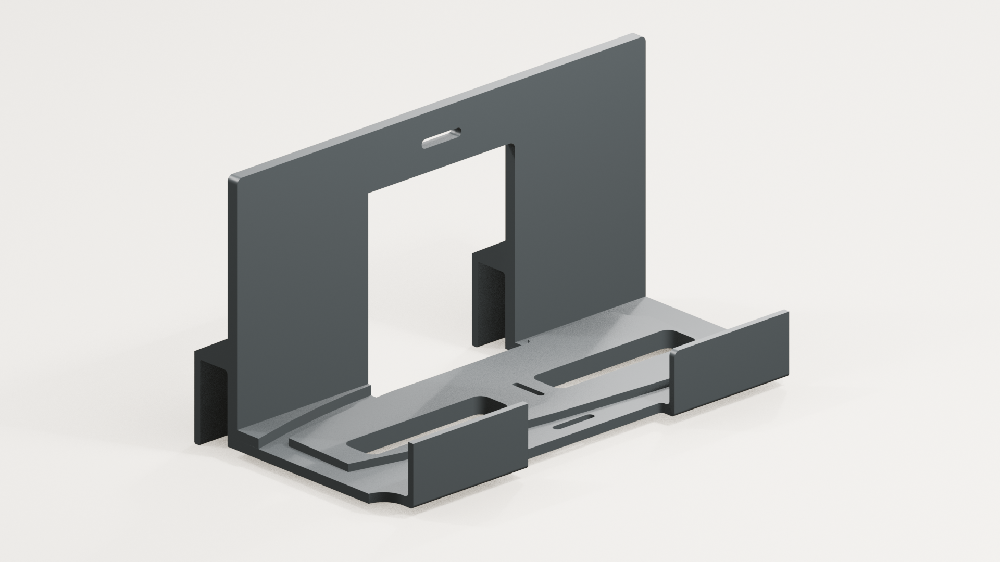

# Pedestal PS5 holder

A printed holder for mounting a PlayStation 5 behind a Pedestal A-frame TV stand. This project preserves the original revisions and presents the complete holder from the existing Blender assembly.

[Watch the holder animation](animations/pedestal-holder.mp4). Eight seconds, 1920 × 1080, 24 fps.

## Choose a model

No final print revision has been confirmed. The rendered holder and the original STL revisions are kept separate.

| File | Dimensions, mm | What it contains |
| --- | --- | --- |
| [Scene V03 candidate](models/candidates/pedestal-holder-scene-v03.stl) | 251.674 × 133.860 × 137.000 | Complete holder exported from the mounted Blender model. Matches the renders. |
| [Original V002](models/archive/pedestal_v002.stl) | 251.674 × 133.860 × 137.000 | Complete earlier holder. Same overall size, different geometry. |
| [V03 bottom](models/archive/pedestal-v03-bottom-001.stl) | 251.545 × 108.739 × 4.233 | Thin bottom piece. Not a complete holder. |
| [V03 measurement piece](models/archive/pedestal-v03-measure-bottom.stl) | 251.545 × 113.592 × 49.764 | Partial bottom geometry. |
| [Original V001](models/archive/pedestal_v001.stl) | 251.579 × 130.860 × 130.000 | Earlier complete revision. |
| [V001 flat prototype](models/archive/pedestal_v001-proto-flat.stl) | 251.579 × 108.860 × 39.712 | Earlier partial prototype. |

The archived STL files are byte-for-byte copies. The scene export preserves the existing mesh, with a rigid change of placement and conversion from metres to millimetres. No redesign, smoothing modifier or added bevel was applied. Original CAD coordinates are retained in the archived files, so centre them on the build plate in your slicer.

[The manifest](models/manifest.json) records dimensions, triangle counts and SHA-256 hashes. [Version notes](models/VERSIONS.md) explain the comparison.

## Source and rendering

[Open the clean holder scene](source/pedestal-holder.blend) in Blender 5.0.1. It includes the holder, procedural materials, studio lights and animated camera. [Rendering notes](rendering/README.md) cover reproduction.

A second animation was made locally using the original Pedestal frame, TV and PlayStation assembly. The original mounting transforms were preserved. Its source scene and finished context media are not included here because the reference assets' publication terms have not been established.

## Validation

The scene holder has 2,047 vertices and 4,114 triangular faces, with no boundary or non-manifold edges. This is a mesh check, not evidence of physical fit or strength. The V002 and rendered holder differ locally by up to approximately 4 mm after coordinate alignment.

Print orientation, material, supports, fasteners, fit, ventilation clearance and load capacity remain unverified. No load rating is claimed. The scene shows an original PS5 reference model; compatibility with Slim or Pro models is not established.

## Rights

The independently authored holder, clean scene, documentation and standalone media use the repository's CC BY-NC 4.0 licence. Rendering code uses MIT. Pedestal and PlayStation names and designs retain their respective rights. This is an independent accessory, not an official or endorsed product. See [repository licensing](../../LICENSING.md).
