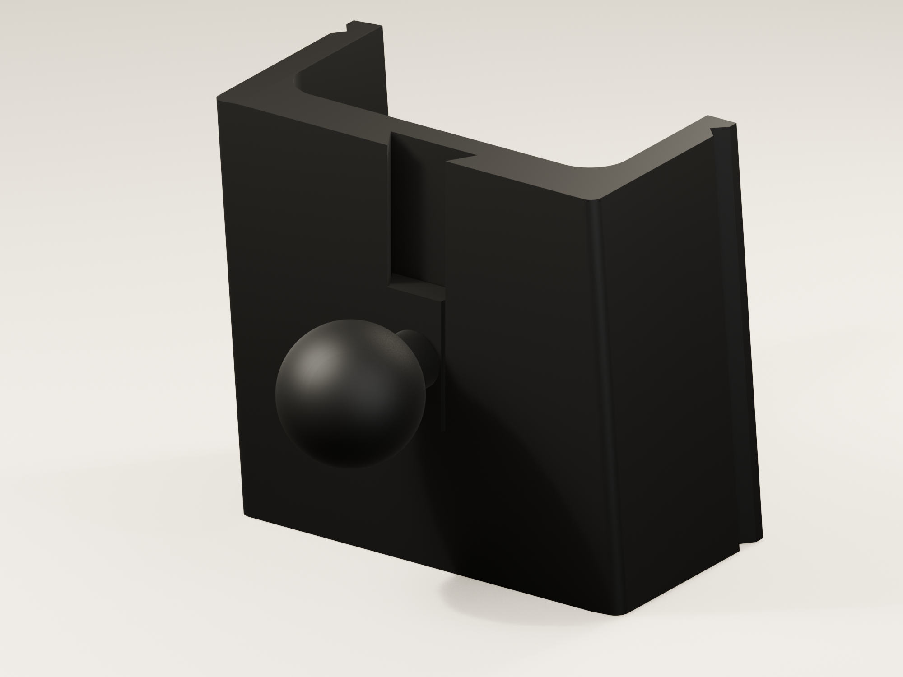
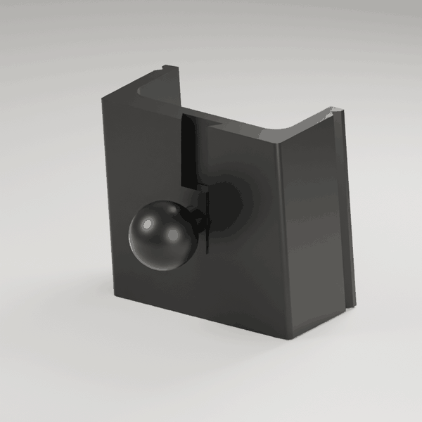
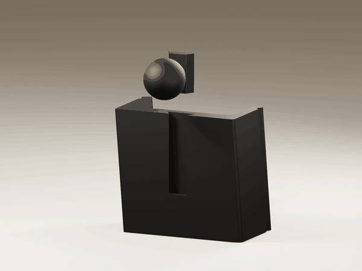
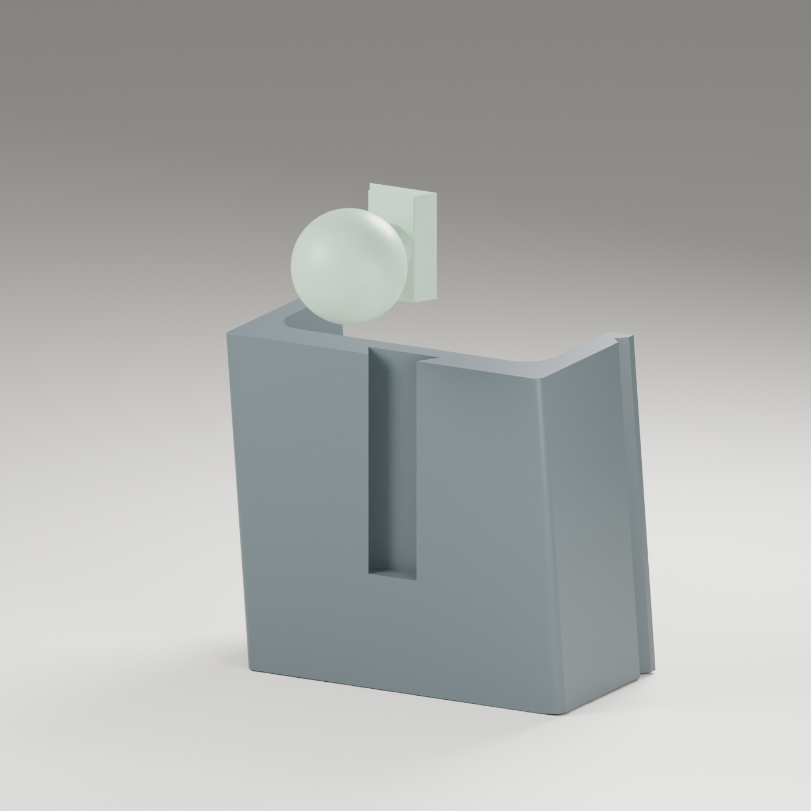
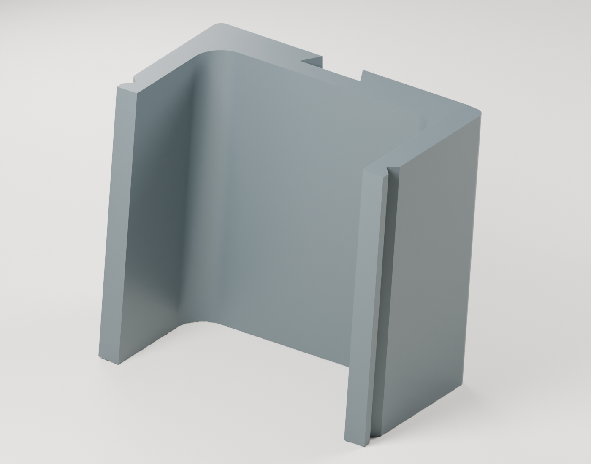
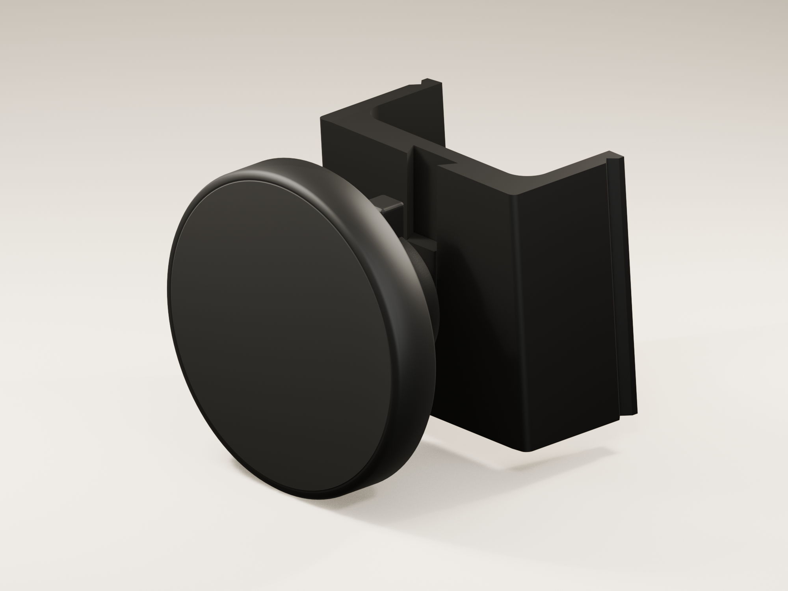
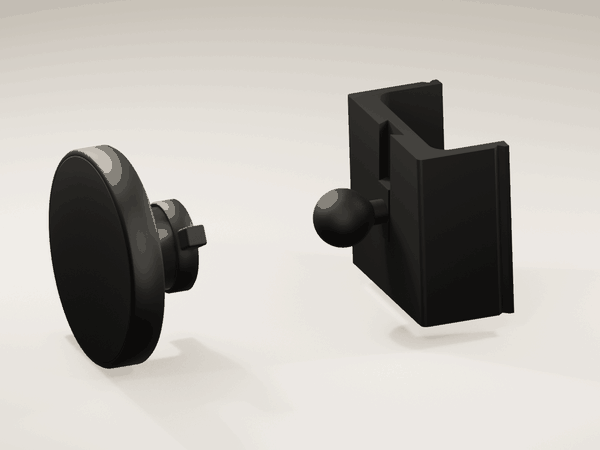
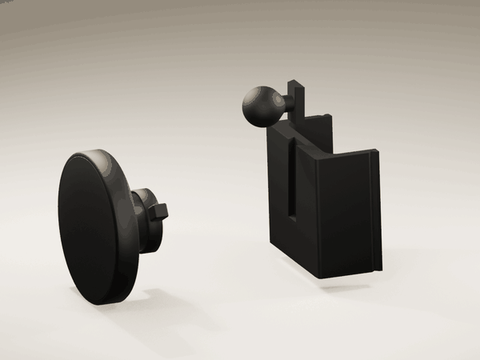

# Volvo XC60 phone holder

Vent mount for the 2022 Volvo XC60 T8, with a separate 17 mm ball module. This is the restored v10 design without cross ribs. It keeps the rounded outer corners and curved reinforcement at both arm roots.

These standalone assembly views follow the [product-rendering skill](../../skills/product-rendering/SKILL.md). Mounted views remain pending an accurate XC60 vent or dashboard model.

## Print files

| File | Use |
| --- | --- |
| [Revised small part, PAHT-CF](models/ball-module-paht-fit.3mf) | Print only the smaller ball module for the existing base |
| [Slider fit test](models/slider-paht-fit-test.3mf) | Short test section to check sliding clearance first |
| [Original two-part project](models/holder-without-ribs.3mf) | Original 17 mm ball module and unchanged base |
| [Base STL](models/base-front-down.stl) | Base already oriented front down |
| [Ball module STL](models/ball-module.stl) | Separate ball module, oriented on its flat back |
| [Editable Blender model](source/holder-without-ribs.blend) | Both parts assembled, in millimetres |

The selected files are in `models/`. Their [SHA-256 hashes](models/SHA256SUMS) identify each file. The original ball module remains available. Earlier ribbed variants are not included.

### PAHT-CF fit revision, 9 November 2026

The owner confirmed that the printed base fits the car. The slider and ball were too tight. The revised small part has a **16.8 mm ball**, a dovetail **0.40 mm narrower overall** (0.20 mm per side), and a **0.30 mm lead-in chamfer**. Dovetail depth remains 3.2 mm. The base geometry is unchanged.

Print the short slider test first, remove the brim fully, and check it against the existing base. Then print the revised ball module. These are initial fit allowances; physical sliding fit and Mous socket grip still need checking. No material expansion factor is assumed.

Both new 3MF files use Bambu PAHT-CF, X1 Carbon 0.4 mm, textured PEI, six walls, 25% infill, 0.2 mm layers, and a 10 mm outer brim with zero gap. The revised ball module slices in about **17 minutes**, using **2.9 g**.

[Revised ball STL](models/ball-module-paht-fit.stl) · [Slider test STL](models/slider-paht-fit-test.stl) · [Editable revised model](source/holder-paht-fit.blend). Existing renders show the original 17 mm model.

## Dimensions and printing

The base is approximately **56.57 × 50.38 × 28.00 mm**. The ball diameter is **17 mm**. Outer corner radii are **1.5 mm**; the curved inner roots have a **5 mm** radius. The root curves occupy 5 mm of clearance inside each arm. Small hook end-face corrections reach approximately 0.31 mm; the hook cross-section and overall envelope are retained.

The saved profile uses a Bambu X1 Carbon, **Bambu PAHT-CF**, a 0.4 mm nozzle, 0.2 mm layers, six walls and 25% infill. Both parts use a **continuous 10 mm outer brim with zero separation**, replacing the automatic brim. Trim the attached brim after printing. Both parts were sliced without supports. The base has an approximately 12 mm bridge across its recessed slide. The recorded slicer estimate is **68 minutes and 22.6 g** for both parts. Check the preview and material settings for your printer.

[View the sliced first layer](analysis/paht-cf-brim-preview.png). The PAHT-CF/brim update changes only print settings; the model geometry and placement are unchanged. [Verification](analysis/paht-cf-brim-checks.json).

## Slow camera view

Both parts are shown in matte black, with warm studio lighting. The camera eases through a small arc over twelve seconds.

[Download the twelve-second camera video](animations/orbit.mp4).

## Assembly

Slide the ball module down into the dovetail from the open top until it reaches the stop. Check the vent clearance and phone position before gluing the module in place. The design uses glue rather than a retaining screw; the animation shows the dry assembly motion.

[Download the six-second assembly video](animations/assembly.mp4). Both parts use the same black finish.

## Mous magnetic head

The [Mous Adhesive Car Mount head](https://eu.mous.co/en-nl/products/magsafe-compatible-adhesive-car-mount) is shown attaching to the printed ball. The original Mous adhesive pedestal is not used in this assembly.

[Watch the ten-second attachment animation](animations/mous-attachment.mp4). The camera moves throughout while the head approaches, seats on the ball and the collar turns to illustrate tightening.

[Watch the fourteen-second full assembly video](animations/full-assembly.mp4). All three components start apart. The ball module slides down into the base, then the Mous head seats on the ball and the collar turns. The camera moves during both steps.

The reference model uses the owner's measurements: **63 mm** head diameter, **10.5 mm** head thickness, **26.37 mm** outside socket/collar diameter and **39 mm** across the two tightening tabs. Total depth is estimated at **28.3 mm** from the photos. Internal socket geometry and the collar's 60° turn are illustrative. Original Mous ball diameter and physical compatibility with this 17 mm printed ball have not been verified.

The [separate head reference](rendering/mous-head-reference.blend), [Mous attachment scene](rendering/mous-attachment.blend) and [full assembly scene](rendering/full-assembly.blend) are presentation models. They are not replacement-part print files or official Mous CAD. The accepted holder print files are unchanged.

## Checks and limits

The selected base export is one closed solid, with no non-manifold edges or zero-area triangles. The 3MF geometry matches the STL within 0.00000005 mm. Seven sampled positions along the module's insertion path show no solid intersection. Bambu Studio completed slicing without reported warnings. Reports are in [analysis](analysis/).

The owner confirmed physical vent fit of the base on 9 November 2026. Revised slider and ball fit, glue retention, strength and resistance to heat remain unverified. The fit revision passed manifold checks and seven sampled insertion positions with no solid intersection. Bambu Studio command-line slicing succeeded; GUI import verification was blocked by an unresponsive file picker. See [fit checks](analysis/paht-fit-checks.json).

## Edit and render

Open the clean Blender source to edit the model. The source contains only the base and ball module. Accepted STL and 3MF files remain separate from rendering work. The [rendering instructions](rendering/README.md) reproduce the images and animation in Blender 5.0.

Models and original media follow the repository's [CC BY-NC 4.0 terms](../../LICENSING.md); the rendering script is MIT. Volvo and Mous names, product designs and trademarks retain their respective rights. This is an independently designed compatible accessory, not an official Volvo product.

Rebuild the fit revision with `blender -b --python source/build_paht_fit.py`, then `python3 source/package_paht_fit.py`, from this project directory.
